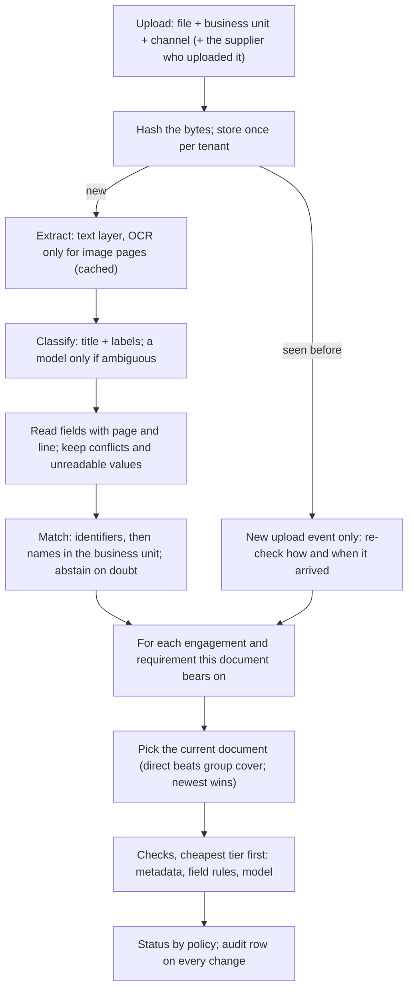
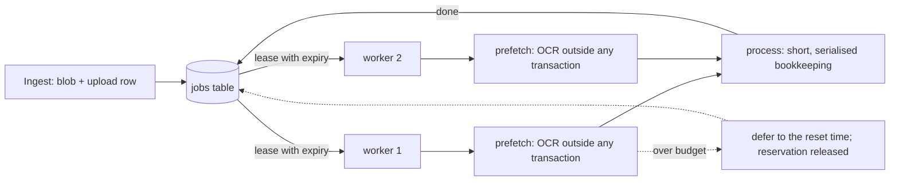

# Architecture

This document explains how TESTAMUR is built and why, decision by decision. The README is the short version; the
[walkthrough](walkthrough.md) follows one document through every stage; the [decision records](decisions/) hold the
trade-offs.

## The job

A buying organisation (a *tenant*) works with many suppliers across several *business units*. Each *engagement* (one
supplier in one business unit, with a risk tier, a type and dates) requires a set of evidence: an insurance
certificate, a security certification, a bank-details letter, a tax registration form, a signed master agreement.
The tenant must be able to show, at any moment and per engagement, that every required document exists, belongs to
that supplier, and says what it should.

The evidence arrives badly: scans and phone photos, filenames that say nothing, the same file uploaded twice, an old
certificate next to its renewal, a parent company's group policy instead of the subsidiary's own, supplier names
that differ by one word across business units, bank letters whose account details quietly changed, and documents
that contain text written for whatever automated system reads them.

The output is a **status per engagement and requirement**, each backed by **verdicts with evidence**: the page and
line the engine read, the rule it applied, and what to do about a failure.

## Pipeline



### Intake and deduplication
Files are content-addressed (SHA-256) **per tenant**. A re-upload of the same bytes adds an upload event and nothing
else: no second extraction, classification or match. Sharing the store across tenants would save little and would
tell one tenant that another holds the same file, so it is not done ([ADR 0004](decisions/0004-per-tenant-dedup.md)).

### Extraction: the cost ladder starts here
Born-digital PDFs carry their text; reading it costs microseconds. Only pages without a usable text layer go to OCR
(RapidOCR on ONNX Runtime, CPU), and every extraction is cached by content and extractor version. A re-index costs no
OCR at all, and the harness measures that every run.

### Classification: deterministic first
A document type is recognised by its title and by the labels it always carries ("Policy number", "Expiry date").
The filename is a weak signal because filenames lie. Only when the rules are ambiguous is a model asked, and its
answer is accepted only above a confidence threshold *and* if the page shows some support for that type.

### Reading fields: never guess a value
Each field is read after its label, from the start of a line, so "Prior period expiry date" is never read as the
expiry date. Values are parsed strictly: "EUR 5,000000" (an OCR slip) is unreadable, not five thousand euros. If a
document states a field twice with different values (an endorsement page contradicting the schedule), the field is a
conflict, and every check that needs it abstains.

### Matching: whose document is this?
1. Identifiers with valid check digits (LEI, IBAN, company number, VAT number) decide outright.
2. Otherwise the name is compared with the suppliers engaged in the business unit the file was uploaded to (plus
   their parent companies). A clear winner decides; an exact legal-name match beats a near twin; if two names tie,
   the uploading supplier's own claim breaks the tie.
3. A strong match in a different business unit is not taken (the file may be misfiled), and nothing can match across
   tenants because the session cannot see other tenants.
4. A supplier uploading evidence that belongs to someone else is stopped.

When it abstains, the engine names the suppliers the document might belong to, so their requirements show NEEDS
REVIEW instead of being judged on older evidence as if the new file did not exist.

### Checks: the cheapest tier that can decide
| Tier | What it reads | Examples | Cost |
|---|---|---|---|
| metadata | facts known before reading: upload channel, dates, the engagement record | received before the engagement started; bank details arrived through a verified channel | free |
| field | a value read from the page, with a deterministic rule | expiry after the as-of date; limit meets the tier minimum; IBAN check digits; IBAN matches the account on file | near free |
| model | located passages of a contract, judged by a language model | liability is capped; the customer may audit; personal data is processed only on instructions | paid per call |

Checks are evaluated only for the **current** document behind a requirement: a superseded certificate is never paid
for. Model checks are **skipped** when a deterministic check has already decided the outcome (no point paying to
learn that an unsigned contract also lacks an audit clause), and **refused** for documents carrying text aimed at
automated readers. See [ADR 0001](decisions/0001-cost-ladder.md).

### The model tier: evidence or nothing
A model's judgement is accepted only if:
- it chose the same statement when asked twice with the two statements in opposite orders (a model answering by
  position or by habit fails this), and
- for a PASS, it copied a sentence from the passage and that sentence is really there.

Otherwise the check abstains. Small local models fail these tests often, which is the point: the engine stays safe
with a weak model and becomes decisive with a better one ([ADR 0005](decisions/0005-two-ordering-judgement.md)).

### Status policy
| Rule, in order | Status |
|---|---|
| the requirement does not apply to this engagement | NOT_REQUIRED |
| no current document; verified by call-back | VERIFIED_OUT_OF_BAND |
| no current document | MISSING |
| no check could be evaluated at all | NEEDS_REVIEW |
| a critical check abstained | NEEDS_REVIEW |
| critical failures are all lapses | EXPIRED |
| any other critical failure | NOT_SATISFIED |
| satisfied through a parent's group policy | COVERED_BY_PARENT |
| a non-critical check failed or abstained | SATISFIED_WITH_FINDINGS |
| everything passed | SATISFIED |
| and: a negative status while an unresolved document might change it | NEEDS_REVIEW |
| and: a vouching status on a document carrying text aimed at automated readers, until a person clears it | NEEDS_REVIEW |

Five statuses *vouch* for the supplier (SATISFIED, SATISFIED_WITH_FINDINGS, COVERED_BY_PARENT,
VERIFIED_OUT_OF_BAND, NOT_REQUIRED). Reporting one of them when the truth is otherwise is the error the gates hold at
zero.

### People in the loop
The engine's abstentions become a **review queue**, derived from the data each time it is read, most consequential
first:

| Item | Why it is there | What a person can do |
|---|---|---|
| document owner | the match abstained (near twins, misfiled, someone else's evidence); its candidates' bad news is held | assign it to a supplier, or reject it |
| document type | no type could be recognised | classify it, or reject it |
| document security | it carries text aimed at automated readers; it cannot vouch | clear it after reading it, or reject it |
| check | the engine could not decide a check of a current document | decide PASS or FAIL, or correct the field it read |

Decisions are **inputs, not edits** ([ADR 0009](decisions/0009-decisions-are-inputs.md)): the engine derives each
document and status from the file plus the decisions about it, so a re-index or a new engine version applies them
again. The engine's own verdict is kept beside each decision, which is what accuracy is measured from. A check
decision is bound to the rule it was made under (the check's definition and the pack tables it reads); change the rule
and the engine judges again. A cleared hostile document may vouch, but its text is still never shown to the model.

```bash
testamur queue --db data/harness.db --tenant 1
testamur review assign 20 14 --by reviewer@buyer --note "misfiled under Head Office"
testamur review field 7 gl_limit "2,000,000 EUR" --by reviewer@buyer --note "schedule on page 2"
testamur review check 8 master_agreement clause_audit_rights PASS --by legal@buyer
```

### Holding accuracy
Abstentions reach people anyway; the dangerous errors are confident ones, which never ask for help. So people also
look at verdicts the engine did *not* ask about ([ADR 0010](decisions/0010-audits-and-the-breaker.md)):

- **Random audits.** A share of conclusive verdicts (10% critical, 5% major, 2% minor) is drawn by a hash of a seed
  and the verdict's identity, independent of what it says: an unbiased, reproducible sample.
- **One number per check:** the share of the engine's PASS verdicts a person overturns, with an exact one-sided 95%
  Clopper-Pearson bound ([`accuracy.py`](../testamur/accuracy.py)). Reviews of abstentions do not count; they are the
  hard cases by construction.
- **Budgets and states.** Critical 1%, major 5%, minor 10%. *Certified* when the upper bound is within budget (299
  clean audits for 1%), *not yet certified* while evidence is thin, *breached* when the lower bound exceeds it, or
  when a critical check has any confirmed false PASS.
- **The breaker.** A breached check's PASS stops vouching ("a person confirms"), and each such PASS joins the queue.
  It resets when a person re-certifies the check after finding the cause, or when the rule changes; only reviews
  under the current rule count. Everything is per tenant.

```bash
testamur audit --db data/harness.db --tenant 1                 # today's sample
testamur review check 3 insurance ins_limit_meets_tier PASS --kind audit --by auditor@buyer
testamur health --db data/harness.db --tenant 1                # accuracy and breaker state per check
testamur review recertify ins_limit_meets_tier --by lead@buyer --note "aggregate limits now read separately"
```

`testamur reviewsim` closes the loop on a world with ground truth: a simulated reviewer works the whole queue (every
status must then be right, and a re-index must change none), and a planted fault shows the audit sample tripping the
breaker and the false assurance stopping.

### Revisions and retries
Verdicts are stored per engagement, requirement, check, document and engine version. A transient failure (a timeout,
a provider error) is recorded as a transient ABSTAIN, retried on the next pass, and never overwrites a conclusive
verdict for the same document.

### Tenant isolation, enforced by the session
Every tenant-owned row carries `tenant_id`. A session opened for a tenant adds that tenant's filter to every read
automatically and refuses to flush a row of another tenant; a session with no tenant cannot read tenant data at all
([ADR 0003](decisions/0003-tenant-isolation-in-the-session.md)). Background work receives the tenant explicitly; there
is no ambient tenant to forget.

### Cost and idempotency
- One extraction per (tenant, file, extractor version).
- One model call per (tenant, model, exact prompt): a ledger at the provider boundary answers repeats for free.
- Usage rows per tenant and day (OCR pages, model tokens, cached or not), the basis for spend gates.
- A cassette records model calls for exact, free replay in CI; a replay-only cassette fails loudly on any call it
  has not seen.

## Throughput and cost



- **Queue** ([`jobs.py`](../testamur/jobs.py), [ADR 0007](decisions/0007-queue-in-the-database.md)): a table in the
  same database; claim by an atomic `UPDATE ... RETURNING` with a lease (visibility timeout); retries with backoff;
  a dead-letter state after the last attempt; deferral that does not count as an attempt; idempotent enqueue.
- **Spend gates** ([`budget.py`](../testamur/budget.py)): per-tenant daily caps for OCR pages and model tokens,
  checked before money is spent, with the allowed amount reserved in the same transaction and settled afterwards.
  Cache hits are always free.
- **Workers** ([`worker.py`](../testamur/worker.py)): separate processes; each job carries its tenant; OCR runs before
  and outside the serialised bookkeeping.
- **Load test** ([`loadtest.py`](../testamur/loadtest.py)): a whole world enqueued at once; scaling across worker
  processes, a spend-cap scenario stretched over simulated days, and a worker killed mid-job. Each scenario checks
  that the final statuses are identical to the plain single-worker run.
- **Shadow trials** ([`shadow.py`](../testamur/shadow.py), [ADR 0008](decisions/0008-shadow-trials.md)): candidate OCR
  engines beside the canonical one, observe-only, decided by a parity gate; the switch is configuration.

## Measurement

The harness generates an adversarial supplier world from a seed (fictional names, rendered and degraded documents,
ground truth for every field, check and requirement), runs the real engine over it, and compares. The truth is
computed from what the generator wrote, by logic independent of the engine; the status policy is shared on purpose,
as the specification ([ADR 0006](decisions/0006-synthetic-world.md)).

Gates (in `gates.yaml`) hold the dangerous direction at zero: no vouching status the truth contradicts, no critical
check saying PASS against a FAIL, no document attached to the wrong supplier. Other gates keep the engine honest about
cost (a re-index pays for nothing) and about how much it hands to people (deferral rate).

`scripts/prove_tests_fire.py` breaks each safety rule on purpose and requires the tests to fail: a test that asserts
"this must not happen" is trusted only after it has been seen catching it.

## What is deliberately not here yet

The roadmap in the README lists what follows: accuracy estimated from audit samples of the engine's confident
verdicts, calibrated thresholds, real-contract evaluation, findings that create work, an assistant over the same
index, and a tenant-scoped tool server for agents.
