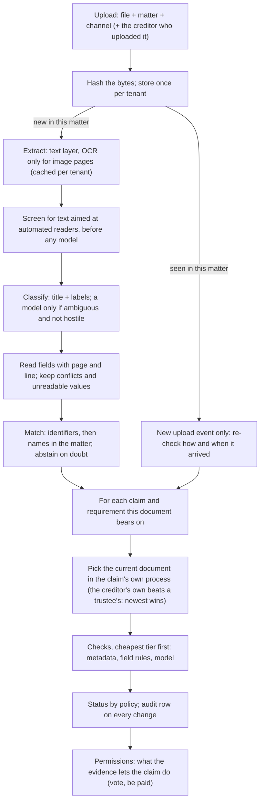
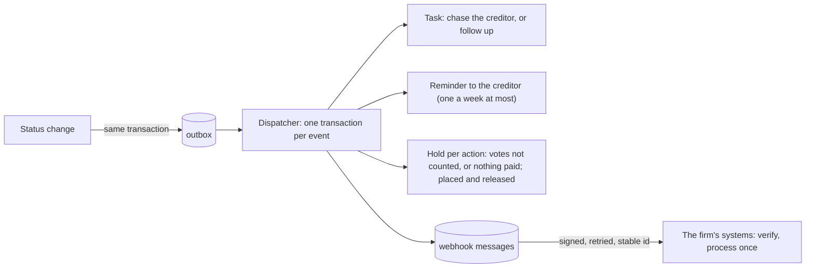
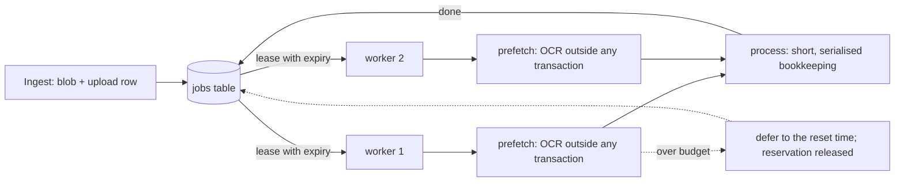

# Architecture

This document explains how TESTAMUR is built and why, decision by decision. The README is the short version; the
[walkthrough](walkthrough.md) follows one document through every stage; the [decision records](decisions/) hold the
trade-offs.

## The job

An insolvency professional's firm (a *tenant*) runs several corporate insolvency resolution processes (*matters*),
each with its corporate debtor, insolvency commencement date, public announcement and last date for claims. Each
*claim* (one financial creditor in one process, with a tier, a type, a facility type and the amounts the corporate
debtor's books show) requires a set of evidence: the proof of claim (Form C), the letter of authority of the
representative who will vote for the creditor, a certificate of registration of charge if the claim is secured, a
bank mandate for payouts, and the facility agreement. The resolution professional must be able to show, per claim,
that every required document exists, belongs to that creditor, and says what it should, as on the commencement date.

The evidence arrives badly: scans and phone photos, filenames that say nothing, the same file uploaded twice, an old
authority next to its renewal, a debenture trustee's authority instead of the holder's own, creditor names that
differ by one word, amounts in words that disagree with the figures, bank letters whose account details quietly
changed, and documents that contain text written for whatever automated system reads them.

The output is a **status per claim and requirement**, each backed by **verdicts with evidence**: the page and
line the engine read, the rule it applied, and what to do about a failure; and, decided apart from it, **what the
evidence permits** for each claim (to vote, to be paid). Evidence counts in the process it was filed in: a creditor
with claims in two processes is judged in each on that process's papers.

## Pipeline



### Intake and deduplication
Files are content-addressed (SHA-256) **per tenant**: bytes and their reading are stored and paid for once. Sharing
the store across tenants would save little and would tell one tenant that another holds the same file, so it is not
done ([ADR 0004](decisions/0004-per-tenant-dedup.md)). A **document** is the file as evidence in one process: one per
(tenant, matter, file). A re-upload of the same bytes in the same process adds an upload event and nothing else; the
same bytes filed in another process are another document, judged there against that process's dates and debtor
([ADR 0015](decisions/0015-evidence-belongs-to-its-process.md)).

### Extraction: the cost ladder starts here
Born-digital PDFs carry their text; reading it costs microseconds. Only pages without a usable text layer go to OCR
(RapidOCR on ONNX Runtime, CPU), and every extraction is cached by content and extractor version. A re-index costs no
OCR at all, and the harness measures that every run.

Two corrections sit on top of the engine, both found by the generated world. The engine's per-line orientation step
now and then turns an upright line upside down, and the recogniser then returns garbage with low confidence ("Aut s
d s u st s fr s ss es." for a perfectly legible line); a line read with less than 0.8 confidence is read again from
its own box, cut out along its slant and turned straight, without that step, and the more confident reading is kept.
And a scan turned by two degrees drifts a long line by more than a line's height, so rows grouped by vertical overlap
would merge neighbouring lines; rows are grouped with the page turned straight, by the median slope of the boxes.

### Classification: deterministic first
A document type is recognised by its title and by the labels it always carries ("Name of the financial creditor",
"Total amount of claim", "Date of default").
The filename is a weak signal because filenames lie. Only when the rules are ambiguous is a model asked, and its
answer is accepted only above a confidence threshold *and* if the page shows some support for that type. A document
that carries text aimed at automated readers is screened before this step and is never shown to the model, not even to
be sorted; the screen folds look-alike letters and removes invisible characters first. It catches the instructions it
knows: it is one signal, and the rest of the design (excerpts only, fixed answer schemas, read-only agents, people
deciding) is what contains the ones it misses.

### Reading fields: never guess a value
Each field is read after its label, from the start of a line, so "Earlier authority valid until" is never read as
the validity date. Values are parsed strictly: rupees in lakh and crore grouping ("Rs. 12,34,56,000/-"), thousands
grouping ("INR 123,456,000") or words ("Rs 25 crore"); "Rs. 12,34,56000" (an OCR slip) is unreadable, not a guess.
Amounts in words are read the Indian way ("Rupees Twelve Crore Thirty-Four Lakh Only"), scales in order or not at
all. Dates are day-first, as Indian documents write them. If a document states a field twice with different values
(an amendment page contradicting the letter), the field is a conflict, and every check that needs it abstains.

### Matching: whose document is this?
1. Identifiers that validate decide: an LEI or a GSTIN by its check characters, a CIN by its structure, a bank account
   as an IFSC with its account number. For evidence of one process, the creditor found must have a claim in the process
   the file was filed in (or act as trustee for a holder who has); otherwise the file is possibly misfiled, and a
   person says where it belongs.
2. Otherwise the name is compared with the creditors with a claim in the process the file was uploaded to (plus the
   debenture trustees acting for them). Legal forms are ignored ("Pvt Ltd", "Private Limited", "(P) Ltd"), but no
   other word is: "Shree Anvaya Fincorp Ltd" is not "Anvaya Fincorp Ltd". A clear winner decides; an exact legal-name
   match beats a near twin; if two names tie, the uploader's own declaration breaks the tie.
3. A strong match in a different matter is not taken (the file may be misfiled), and nothing can match across
   tenants because the session cannot see other tenants.
4. A creditor uploading evidence that belongs to someone else is stopped.

When it abstains, the engine names the creditors the document might belong to, so their requirements show NEEDS
REVIEW instead of being judged on older evidence as if the new file did not exist.

### Checks: the cheapest tier that can decide
| Tier | What it reads | Examples | Cost |
|---|---|---|---|
| metadata | facts known before reading: upload channel, dates, the claim record | received by the last date for claims; bank details arrived through a verified channel | free |
| field | a value read from the page, with a deterministic rule | the form's corporate debtor is this process's; default within three years of commencement (outside them, a question for a person); claim within the books; words agree with figures; GSTIN check character and the PAN inside it; IFSC of the bank named; account on file; authority in effect, current, and granting the vote in plain words; charge over the debtor, by a Registrar, covering the facility; the loan's borrower is the debtor | near free |
| model | located passages of an agreement, judged by a language model | money was disbursed; interest is payable; security is created for the lender; the lender may assign | paid per call |

Checks are evaluated only for the **current** document behind a requirement: a superseded authority is never paid
for. Model checks are **skipped** when a deterministic check has already decided the outcome (no point paying to
learn that an unsigned agreement also lacks an interest clause), and **refused** for documents carrying text aimed at
automated readers. See [ADR 0001](decisions/0001-cost-ladder.md).

### The model tier: evidence or nothing
A model's judgement is accepted only if:
- it chose the same statement when asked twice with the two statements in opposite orders (a model answering by
  position or by habit fails this), and
- for a PASS, it copied a sentence from the passage and that sentence is really there.

Otherwise the check abstains. Small local models fail these tests often, which is the point: the engine stays safe
with a weak model and becomes decisive with a better one ([ADR 0005](decisions/0005-two-ordering-judgement.md)).

### Status policy
| Rule, in order | Status |
|---|---|
| the requirement does not apply to this claim | NOT_REQUIRED |
| no current document; verified by call-back | VERIFIED_OUT_OF_BAND |
| no current document | MISSING |
| no check could be evaluated at all | NEEDS_REVIEW |
| a critical check abstained | NEEDS_REVIEW |
| critical failures are all lapses | EXPIRED |
| any other critical failure | NOT_SATISFIED |
| satisfied through a debenture trustee's authority that lists the creditor | COVERED_BY_TRUSTEE |
| a non-critical check failed or abstained | SATISFIED_WITH_FINDINGS |
| everything passed | SATISFIED |
| and: a negative status while an unresolved document might change it | NEEDS_REVIEW |
| and: trustee cover while an unresolved document may be the creditor's own (which would take precedence) | NEEDS_REVIEW |
| and: a vouching status on a document carrying text aimed at automated readers, until a person clears it | NEEDS_REVIEW |

Five statuses *vouch* for the creditor (SATISFIED, SATISFIED_WITH_FINDINGS, COVERED_BY_TRUSTEE,
VERIFIED_OUT_OF_BAND, NOT_REQUIRED). Reporting one of them when the truth is otherwise is the error the gates hold at
zero.

A rule that states only the usual case of the law says so in the pack (`illustrative`, with the date its wording was
reviewed and its basis) and leaves the exceptions to a person: a default outside three years abstains, because a
written acknowledgement could extend limitation, instead of failing on the date alone.

### What the evidence permits
Whether a document suffices and what the claim may do are separate decisions
([ADR 0016](decisions/0016-what-a-document-suffices-for.md)). An authority that lets the representative file but
not vote is good enough as a document (a major finding: SATISFIED_WITH_FINDINGS), and still no vote is counted. The
pack lists each action's conditions: to vote, a proof of claim, an authority in a vouching status and the voting check
PASS; a payout, a proof of claim and bank details without any finding. The engine stores a permission per claim and
action with the unmet conditions named, reports changes through the outbox, and the harness gates a vote or payout
permitted when the truth withholds it at zero. The engine recommends; votes and payments are made elsewhere and are
simulated here.

The voting check reads the clause that names the power, not the word: "is not authorised to vote", "may not vote",
"voting rights are withdrawn" fail; "subject to the approval of the board", "only on", a later date, or a grant beside
a restriction go to a person; no clause naming the power fails.

### People in the loop
The engine's abstentions become a **review queue**, derived from the data each time it is read, most consequential
first:

| Item | Why it is there | What a person can do |
|---|---|---|
| document owner | the match abstained (near twins, misfiled, someone else's evidence); its candidates' bad news is held | assign it to a creditor, or reject it |
| document type | no type could be recognised | classify it, or reject it |
| document security | it carries text aimed at automated readers; it cannot vouch | clear it after reading it, or reject it |
| check | the engine could not decide a check of a current document | decide PASS or FAIL, or correct the field it read |

Decisions are **inputs, not edits** ([ADR 0009](decisions/0009-decisions-are-inputs.md)): the engine derives each
document and status from the file plus the decisions about it, so a re-index or a new engine version applies them
again. The engine's own verdict is kept beside each decision, which is what accuracy is measured from. A check
decision is bound to the rule it was made under (the check's definition, the pack tables it reads and the rule's own
version, which a test holds to the rule's code); change the rule and the engine judges again. A cleared hostile
document may vouch, but its text is still never shown to the model.

```bash
testamur queue --db data/harness.db --tenant 1
testamur review assign 20 14 --by reviewer@firm --note "filed under the wrong process"
testamur review field 7 default_date "14.03.2024" --by reviewer@firm --note "annexure 2, the ledger"
testamur review check 8 evidence_of_debt clause_interest PASS --by legal@firm
```

### Holding accuracy
Abstentions reach people anyway; the dangerous errors are confident ones, which never ask for help. So people also
look at verdicts the engine did *not* ask about ([ADR 0010](decisions/0010-audits-and-the-breaker.md)):

- **Random audits.** A share of conclusive verdicts (10% critical, 5% major, 2% minor) is drawn by a hash of a seed
  and the verdict's identity, independent of what it says: an unbiased, reproducible sample.
- **One number per check:** the share of the engine's PASS verdicts a person overturns, with an exact one-sided 95%
  Clopper-Pearson bound ([`accuracy.py`](../testamur/accuracy.py)). Reviews of abstentions do not count; they are the
  hard cases by construction.
- **Budgets and states.** Critical 1%, major 5%, minor 10%. *Certified* when the upper bound is within budget (299
  clean audits for 1%), *not yet certified* while evidence is thin, *breached* when the lower bound exceeds it, or
  when a critical check has any confirmed false PASS.
- **The breaker.** A breached check's PASS stops vouching ("a person confirms"), and each such PASS joins the queue.
  It resets when a person re-certifies the check after finding the cause, or when the rule changes; only reviews
  under the current rule count. Everything is per tenant.

```bash
testamur audit --db data/harness.db --tenant 1                 # today's sample
testamur review check 3 proof_of_claim claim_within_books PASS --kind audit --by auditor@firm
testamur health --db data/harness.db --tenant 1                # accuracy and breaker state per check
testamur review recertify claim_not_time_barred --by lead@firm --note "limitation read as three years again"
```

`testamur reviewsim` closes the loop on a world with ground truth: a simulated reviewer works the whole queue (every
status must then be right, and a re-index must change none), and a planted fault shows the audit sample tripping the
breaker and the false vouching stopping.

### From finding to action


Every status or permission change writes an event in the same transaction as the change; the dispatcher turns each
event into work in one transaction with its dispatched mark, so a crash re-handles it from scratch and the database
keeps every action single (one open task per requirement, one open hold per claim and action, unique keys on reminders
and messages). Webhook messages leave after the transaction, signed (Standard Webhooks), retried with backoff and
declared dead after eight attempts: delivery is at least once, and the id is stable, so a receiver that keeps the ids
it has processed acts on each once (the simulated receiver keeps them in memory)
([ADR 0011](decisions/0011-findings-become-work-through-an-outbox.md)). The first workflow automated is the chase
for a creditor's lapsing authority: frequent, decided by rules, reversible, and due before every vote
([ADR 0012](decisions/0012-the-first-workflow.md)). Verdicts that depend on the date carry the date they were judged
at and are judged again when it moves, so an authority that lapses tonight is EXPIRED tomorrow without a new upload.

```bash
testamur dispatch --db data/harness.db --tenant 1      # findings become tasks, reminders, holds, messages
testamur tasks --db data/harness.db --tenant 1         # open work, and claims on hold
testamur actionsim --world data/world --days 60        # days pass; creditors answer; the loop is measured
```

### The assistant
Staff ask in their own words; the assistant answers from the engine's records wherever it can (standing, dates,
amounts, findings), so it inherits the engine's readings and people's decisions, and it cites the page and line it
read ([`assistant.py`](../testamur/assistant.py), [ADR 0013](decisions/0013-the-assistant-answers-from-the-records.md)).
Filters come before ranking: the tenant (the session), the process when the question names its debtor, the creditor
(the capitalised name in the question, compared whole, asked back when a first word fits several), and the current
document behind each requirement of each claim; a creditor with current documents in two processes is asked which one
is meant, and a claim with no evidence of its own is never answered from another process's. Every quote
must be found on the cited page. What the engine could not settle is said as such. Free-text questions use hybrid
retrieval (BM25 and character trigrams, fused by reciprocal rank) over current passages, never over passages that
address automated readers.

```bash
testamur ask "How much has Anvaya Fincorp Ltd claimed?" --db data/harness.db --tenant 1
testamur golden --world data/world --db data/harness.db       # the golden set, traps included
```

### A tool surface for agents
A firm's own agents connect over the Model Context Protocol ([`mcp_server.py`](../testamur/mcp_server.py),
[`agents.py`](../testamur/agents.py), [ADR 0014](decisions/0014-agents-propose-people-dispose.md)). A key belongs
to one named agent of one tenant and is stored as a hash; every tool runs in that tenant's session. The tenant's
catalogue decides which tools exist for its agents, for all of them or one by name: only granted tools are listed, and
the key and the grant are both checked on every call, so revoking either takes effect at once. Reads (claims, a
requirement with its checks, the review queue, open tasks, the assistant) paginate with a fixed number of queries per
page. There are no write tools: an agent proposes a check verdict, a field reading or a document decision, bound to
the evidence it was made on, and a person confirms or declines it. Confirmation is one transaction that derives the
binding again (a proposal made on evidence that has since changed is refused as stale), applies the change under the
person's name with the agent's beside it, and writes its audit and outbox event; the effect carries the proposal's id
under a unique key, so it exists once.

```bash
testamur keys create assistant-bot --tenant 1                  # shown once; stored as a hash
testamur tools grant ask --by admin@firm --tenant 1            # the tenant's catalogue
TESTAMUR_API_KEY=tsk_... testamur mcp --db data/harness.db     # stdio MCP server for that agent
testamur proposals list --tenant 1                             # what agents asked for
testamur proposals confirm 3 --by reviewer@firm --tenant 1     # a person applies it
```

### Investigations: two agents and a person
For what rules cannot decide but a careful reader can (an authority granting the vote "subject to the board's
approval" that records the approval two lines down), a reviewer can ask for an investigation
([`investigate/`](../testamur/investigate/), [ADR 0017](decisions/0017-an-investigator-and-a-verifier.md)). An
*investigator* reads the claim's evidence through read-only tools and answers with a typed evidence packet, each
finding citing a document, a page and words copied from it; a *verifier*, in a separate context with its own tools,
checks each finding and looks for what was missed. A coordinator in code validates every citation against the page,
reconciles the two answers with each other and with the rules, and alone creates proposals, only for checks the rules
could not decide; disagreement goes to a person. The run is a LangGraph graph checkpointed after every step: a crash
resumes at the step it was on, a restart during review resumes at the approval, and every step that can run twice is
idempotent. Budgets bound steps, tokens, time and tool calls per agent. `mode="single"` (the investigator alone) is the
baseline the pair is measured against.

### The service
A FastAPI service puts the engine in front of people and other systems ([`service/`](../testamur/service/),
[ADR 0018](decisions/0018-a-service-for-reviewers.md)): a JSON API (`/api/v1`, described at `/docs`) and a
server-rendered review page. Keys carry a role (agent, uploader, reviewer) and are checked by hash on every request;
the review page signs a session holding only the key's hash, and every form carries a CSRF token. Uploads and
investigations are queued for workers; a reviewer's approval is applied in the request, atomically and against the
digest the reviewer was shown. Processes are stateless: Postgres (with tenant sessions as an application role under
row-level security), an S3-compatible object store and the workflow's checkpoints are shared, so API and worker
processes scale apart. The schema is migrated by Alembic, row-level security included. Every request and job is one
OpenTelemetry trace, with a span per stage, agent step, tool call and approval, carrying identifiers only.

```bash
docker compose up --build                  # Postgres, object store, Jaeger, migrations, API, worker
docker compose logs seed                   # the synthetic world's sign-in keys
python scripts/dev_service.py              # or one process on SQLite, no Docker
```

### Revisions and retries
Verdicts are stored per claim, requirement, check, document and engine version. A transient failure (a timeout,
a provider error) is recorded as a transient ABSTAIN, retried on the next pass, and never overwrites a conclusive
verdict for the same document.

### Tenant isolation, enforced by the session and the database
Every tenant-owned row carries `tenant_id`. A session opened for a tenant adds that tenant's filter to every ORM
statement it runs, bulk UPDATE and DELETE included, refuses what the filter cannot reach (textual and Core SQL, bulk
INSERT and upserts, bulk updates by primary key, an UPDATE that would move rows to another tenant), and refuses to
flush or delete a row of another tenant; a session with no tenant cannot touch tenant data at all
([ADR 0003](decisions/0003-tenant-isolation-in-the-session.md)). Under it, references between tenant rows are foreign
keys on (tenant_id, id), and on Postgres row-level security under a restricted application role refuses other
tenants' rows to any statement. Background work receives the tenant explicitly; there is no ambient tenant to
forget.

### Cost and idempotency
- One extraction per (tenant, file, extractor version).
- One model call per (tenant, model, exact prompt), answered again for free only by the same weights: each answer
  carries the model's fingerprint (a hash of the GGUF file and the runtime), so new weights under an old file name are
  asked afresh.
- Verdicts are cached per engine version, which includes a fingerprint of the code that turns evidence into verdicts,
  so a code change is a new engine even without a version bump.
- Usage rows per tenant and day (OCR pages, model tokens, cached or not), the basis for spend gates.
- A cassette records model calls for exact, free replay in CI; a replay-only cassette fails loudly on any call it
  has not seen.

## Throughput and cost



- **Queue** ([`jobs.py`](../testamur/jobs.py), [ADR 0007](decisions/0007-queue-in-the-database.md)): a table in the
  same database; claim by an atomic `UPDATE ... RETURNING` with a lease (visibility timeout) carrying a fresh token;
  completing, failing, deferring or renewing needs the token, so a worker that stalled past its lease cannot finish a
  job another worker holds; long work renews its lease with every OCR page; retries with backoff; a dead-letter state
  after the last attempt, or after the lease ran out on every attempt; deferral that does not count as an attempt;
  idempotent enqueue. The reading lock on a file is fenced the same way.
- **Spend gates** ([`budget.py`](../testamur/budget.py)): per-tenant daily caps for OCR pages and model tokens,
  checked before money is spent, with the allowed amount reserved in the same transaction and settled afterwards.
  Cache hits are always free.
- **Workers** ([`worker.py`](../testamur/worker.py)): separate processes; each job carries its tenant; OCR runs before
  and outside the serialised bookkeeping.
- **Load test** ([`loadtest.py`](../testamur/loadtest.py)): a whole world enqueued at once; scaling across worker
  processes, a spend-cap scenario stretched over simulated days, and a worker killed mid-job. Each scenario checks
  that the final statuses are identical to the plain single-worker run.
- **Shadow trials** ([`shadow.py`](../testamur/shadow.py), [ADR 0008](decisions/0008-shadow-trials.md)): candidate OCR
  engines beside the canonical one, observe-only, decided by a parity gate; the switch is configuration.

## Measurement

The harness generates an adversarial world of insolvency processes from a seed (fictional names, rendered and degraded documents,
ground truth for every field, check and requirement), runs the real engine over it, and compares. The truth is
computed from what the generator wrote, by logic independent of the engine; the status policy is shared on purpose,
as the specification ([ADR 0006](decisions/0006-synthetic-world.md)).

Gates (in `gates.yaml`) hold the dangerous direction at zero: no vouching status the truth contradicts, no critical
check saying PASS against a FAIL, no document attached to the wrong creditor. Other gates keep the engine honest about
cost (a re-index pays for nothing) and about how much it hands to people (deferral rate).

`scripts/prove_tests_fire.py` breaks each safety rule on purpose and requires the tests to fail: a test that asserts
"this must not happen" is trusted only after it has been seen catching it. How a change ships, gate by gate, is in
[delivery.md](delivery.md).

## What is deliberately not here yet

- **Operational creditors and information utilities.** This pack covers financial creditors' claims. A small second
  pack for operational creditors (Form B and invoices) lives in the tests, to show the engine runs another domain from
  its pack alone; a full one, and records of default from an information utility, would be the next documents. What
  stays domain-specific outside the pack: the assistant's question words, and the world generator with its truth.
- **Real agreements.** The clause tier is measured on synthetic clauses; an evaluation on expert-labelled public
  contracts is the next measurement.
- **Single sign-on.** People sign in to the service with a key made for them; a deployment would put an identity
  provider in front and map its identities to principals and roles.
- **A generative layer in the assistant.** It answers from records and quotes passages; a model could phrase answers
  behind the same citation check.
- **Per-tenant policy.** One domain pack serves every tenant; budgets, audit rates and action policy are pack-wide.
- **The law beyond the pack.** The checks are illustrative rules, not a statement of the law; where a rule states only
  the usual case (limitation as three years from the default) it abstains on the rest and a person decides.
- **The outside world.** Reminders are written, not e-mailed; webhooks are signed and retried, but the receivers in
  the simulations are simulated.
- **Production operations.** The Compose stack shows the deployment's shape (stateless processes, shared state, a
  restricted database role, traces) and runs in CI; there is no TLS termination, rate limiting, backup, alerting or
  load testing of the service itself.
