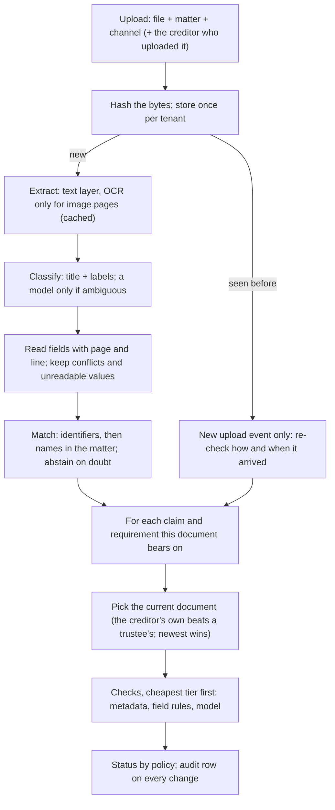
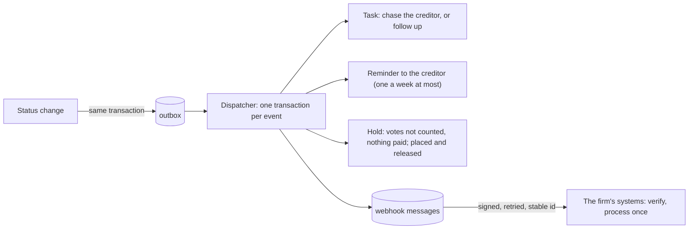
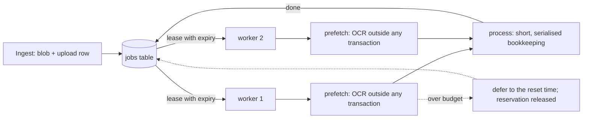

# Architecture

This document explains how TESTAMUR is built and why, decision by decision. The README is the short version; the
[walkthrough](walkthrough.md) follows one document through every stage; the [decision records](decisions/) hold the
trade-offs.

## The job

An insolvency professional's firm (a *tenant*) runs several corporate insolvency resolution processes (*matters*),
each with its corporate debtor, insolvency commencement date, public announcement and last date for claims. Each
*claim* (one financial creditor in one process, with a tier, a type, a facility type and the amounts the corporate
debtor's books show) requires a set of evidence: the proof of claim (Form C), the letter of authority of the
representative who will vote for the creditor, a certificate of registration of charge if the claim is secured, a
bank mandate for payouts, and the facility agreement. The resolution professional must be able to show, per claim,
that every required document exists, belongs to that creditor, and says what it should, as on the commencement date.

The evidence arrives badly: scans and phone photos, filenames that say nothing, the same file uploaded twice, an old
authority next to its renewal, a debenture trustee's authority instead of the holder's own, creditor names that
differ by one word, amounts in words that disagree with the figures, bank letters whose account details quietly
changed, and documents that contain text written for whatever automated system reads them.

The output is a **status per claim and requirement**, each backed by **verdicts with evidence**: the page and
line the engine read, the rule it applied, and what to do about a failure.

## Pipeline



### Intake and deduplication
Files are content-addressed (SHA-256) **per tenant**. A re-upload of the same bytes adds an upload event and nothing
else: no second extraction, classification or match. Sharing the store across tenants would save little and would
tell one tenant that another holds the same file, so it is not done ([ADR 0004](decisions/0004-per-tenant-dedup.md)).

### Extraction: the cost ladder starts here
Born-digital PDFs carry their text; reading it costs microseconds. Only pages without a usable text layer go to OCR
(RapidOCR on ONNX Runtime, CPU), and every extraction is cached by content and extractor version. A re-index costs no
OCR at all, and the harness measures that every run.

### Classification: deterministic first
A document type is recognised by its title and by the labels it always carries ("Name of the financial creditor",
"Total amount of claim", "Date of default").
The filename is a weak signal because filenames lie. Only when the rules are ambiguous is a model asked, and its
answer is accepted only above a confidence threshold *and* if the page shows some support for that type.

### Reading fields: never guess a value
Each field is read after its label, from the start of a line, so "Earlier authority valid until" is never read as
the validity date. Values are parsed strictly: rupees in lakh and crore grouping ("Rs. 12,34,56,000/-"), thousands
grouping ("INR 123,456,000") or words ("Rs 25 crore"); "Rs. 12,34,56000" (an OCR slip) is unreadable, not a guess.
Amounts in words are read the Indian way ("Rupees Twelve Crore Thirty-Four Lakh Only"), scales in order or not at
all. Dates are day-first, as Indian documents write them. If a document states a field twice with different values
(an amendment page contradicting the letter), the field is a conflict, and every check that needs it abstains.

### Matching: whose document is this?
1. Identifiers that validate decide outright: an LEI or a GSTIN by its check characters, a CIN by its structure, a
   bank account as an IFSC with its account number.
2. Otherwise the name is compared with the creditors with a claim in the process the file was uploaded to (plus the
   debenture trustees acting for them). Legal forms are ignored ("Pvt Ltd", "Private Limited", "(P) Ltd"), but no
   other word is: "Shree Anvaya Fincorp Ltd" is not "Anvaya Fincorp Ltd". A clear winner decides; an exact legal-name
   match beats a near twin; if two names tie, the uploader's own declaration breaks the tie.
3. A strong match in a different matter is not taken (the file may be misfiled), and nothing can match across
   tenants because the session cannot see other tenants.
4. A creditor uploading evidence that belongs to someone else is stopped.

When it abstains, the engine names the creditors the document might belong to, so their requirements show NEEDS
REVIEW instead of being judged on older evidence as if the new file did not exist.

### Checks: the cheapest tier that can decide
| Tier | What it reads | Examples | Cost |
|---|---|---|---|
| metadata | facts known before reading: upload channel, dates, the claim record | received by the last date for claims; bank details arrived through a verified channel | free |
| field | a value read from the page, with a deterministic rule | default within three years of commencement; claim within the books; words agree with figures; GSTIN check character and the PAN inside it; IFSC of the bank named; account on file; authority current and covering voting; charge over the debtor, by a Registrar, covering the facility | near free |
| model | located passages of an agreement, judged by a language model | money was disbursed; interest is payable; security is created for the lender; the lender may assign | paid per call |

Checks are evaluated only for the **current** document behind a requirement: a superseded authority is never paid
for. Model checks are **skipped** when a deterministic check has already decided the outcome (no point paying to
learn that an unsigned agreement also lacks an interest clause), and **refused** for documents carrying text aimed at
automated readers. See [ADR 0001](decisions/0001-cost-ladder.md).

### The model tier: evidence or nothing
A model's judgement is accepted only if:
- it chose the same statement when asked twice with the two statements in opposite orders (a model answering by
  position or by habit fails this), and
- for a PASS, it copied a sentence from the passage and that sentence is really there.

Otherwise the check abstains. Small local models fail these tests often, which is the point: the engine stays safe
with a weak model and becomes decisive with a better one ([ADR 0005](decisions/0005-two-ordering-judgement.md)).

### Status policy
| Rule, in order | Status |
|---|---|
| the requirement does not apply to this claim | NOT_REQUIRED |
| no current document; verified by call-back | VERIFIED_OUT_OF_BAND |
| no current document | MISSING |
| no check could be evaluated at all | NEEDS_REVIEW |
| a critical check abstained | NEEDS_REVIEW |
| critical failures are all lapses | EXPIRED |
| any other critical failure | NOT_SATISFIED |
| satisfied through a debenture trustee's authority that lists the creditor | COVERED_BY_TRUSTEE |
| a non-critical check failed or abstained | SATISFIED_WITH_FINDINGS |
| everything passed | SATISFIED |
| and: a negative status while an unresolved document might change it | NEEDS_REVIEW |
| and: trustee cover while an unresolved document may be the creditor's own (which would take precedence) | NEEDS_REVIEW |
| and: a vouching status on a document carrying text aimed at automated readers, until a person clears it | NEEDS_REVIEW |

Five statuses *vouch* for the creditor (SATISFIED, SATISFIED_WITH_FINDINGS, COVERED_BY_TRUSTEE,
VERIFIED_OUT_OF_BAND, NOT_REQUIRED). Reporting one of them when the truth is otherwise is the error the gates hold at
zero.

### People in the loop
The engine's abstentions become a **review queue**, derived from the data each time it is read, most consequential
first:

| Item | Why it is there | What a person can do |
|---|---|---|
| document owner | the match abstained (near twins, misfiled, someone else's evidence); its candidates' bad news is held | assign it to a creditor, or reject it |
| document type | no type could be recognised | classify it, or reject it |
| document security | it carries text aimed at automated readers; it cannot vouch | clear it after reading it, or reject it |
| check | the engine could not decide a check of a current document | decide PASS or FAIL, or correct the field it read |

Decisions are **inputs, not edits** ([ADR 0009](decisions/0009-decisions-are-inputs.md)): the engine derives each
document and status from the file plus the decisions about it, so a re-index or a new engine version applies them
again. The engine's own verdict is kept beside each decision, which is what accuracy is measured from. A check
decision is bound to the rule it was made under (the check's definition and the pack tables it reads); change the rule
and the engine judges again. A cleared hostile document may vouch, but its text is still never shown to the model.

```bash
testamur queue --db data/harness.db --tenant 1
testamur review assign 20 14 --by reviewer@firm --note "filed under the wrong process"
testamur review field 7 default_date "14.03.2024" --by reviewer@firm --note "annexure 2, the ledger"
testamur review check 8 evidence_of_debt clause_interest PASS --by legal@firm
```

### Holding accuracy
Abstentions reach people anyway; the dangerous errors are confident ones, which never ask for help. So people also
look at verdicts the engine did *not* ask about ([ADR 0010](decisions/0010-audits-and-the-breaker.md)):

- **Random audits.** A share of conclusive verdicts (10% critical, 5% major, 2% minor) is drawn by a hash of a seed
  and the verdict's identity, independent of what it says: an unbiased, reproducible sample.
- **One number per check:** the share of the engine's PASS verdicts a person overturns, with an exact one-sided 95%
  Clopper-Pearson bound ([`accuracy.py`](../testamur/accuracy.py)). Reviews of abstentions do not count; they are the
  hard cases by construction.
- **Budgets and states.** Critical 1%, major 5%, minor 10%. *Certified* when the upper bound is within budget (299
  clean audits for 1%), *not yet certified* while evidence is thin, *breached* when the lower bound exceeds it, or
  when a critical check has any confirmed false PASS.
- **The breaker.** A breached check's PASS stops vouching ("a person confirms"), and each such PASS joins the queue.
  It resets when a person re-certifies the check after finding the cause, or when the rule changes; only reviews
  under the current rule count. Everything is per tenant.

```bash
testamur audit --db data/harness.db --tenant 1                 # today's sample
testamur review check 3 proof_of_claim claim_within_books PASS --kind audit --by auditor@firm
testamur health --db data/harness.db --tenant 1                # accuracy and breaker state per check
testamur review recertify claim_not_time_barred --by lead@firm --note "limitation read as three years again"
```

`testamur reviewsim` closes the loop on a world with ground truth: a simulated reviewer works the whole queue (every
status must then be right, and a re-index must change none), and a planted fault shows the audit sample tripping the
breaker and the false vouching stopping.

### From finding to action


Every status change writes an event in the same transaction as the change; the dispatcher turns each event into
work in one transaction with its dispatched mark, so a crash re-handles it from scratch and the database keeps every
action single (one open task per requirement, one open hold per claim, unique keys on reminders and messages).
Webhook messages leave after the transaction, signed (Standard Webhooks), retried with backoff and declared dead
after eight attempts; their id is stable, so the receiver processes each once
([ADR 0011](decisions/0011-findings-become-work-through-an-outbox.md)). The first workflow automated is the chase
for a creditor's lapsing authority: frequent, decided by rules, reversible, and due before every vote
([ADR 0012](decisions/0012-the-first-workflow.md)). Verdicts that depend on the date carry the date they were judged
at and are judged again when it moves, so an authority that lapses tonight is EXPIRED tomorrow without a new upload.

```bash
testamur dispatch --db data/harness.db --tenant 1      # findings become tasks, reminders, holds, messages
testamur tasks --db data/harness.db --tenant 1         # open work, and claims on hold
testamur actionsim --world data/world --days 60        # days pass; creditors answer; the loop is measured
```

### The assistant
Staff ask in their own words; the assistant answers from the engine's records wherever it can (standing, dates,
amounts, findings), so it inherits the engine's readings and people's decisions, and it cites the page and line it
read ([`assistant.py`](../testamur/assistant.py), [ADR 0013](decisions/0013-the-assistant-answers-from-the-records.md)).
Filters come before ranking: the tenant (the session), the creditor (the capitalised name in the question, compared
whole, asked back when a first word fits several), and the current document behind each requirement. Every quote
must be found on the cited page. What the engine could not settle is said as such. Free-text questions use hybrid
retrieval (BM25 and character trigrams, fused by reciprocal rank) over current passages, never over passages that
address automated readers.

```bash
testamur ask "How much has Anvaya Fincorp Ltd claimed?" --db data/harness.db --tenant 1
testamur golden --world data/world --db data/harness.db       # the golden set, traps included
```

### A tool surface for agents
A firm's own agents connect over the Model Context Protocol ([`mcp_server.py`](../testamur/mcp_server.py),
[`agents.py`](../testamur/agents.py), [ADR 0014](decisions/0014-agents-propose-people-dispose.md)). A key belongs
to one named agent of one tenant and is stored as a hash; every tool runs in that tenant's session. The tenant's
catalogue decides which tools exist for its agents: only granted tools are listed, and the grant is checked on every
call. Reads (claims, a requirement with its checks, the review queue, open tasks, the assistant) paginate with
a fixed number of queries per page. There are no write tools: an agent proposes a check verdict, a field reading or
a document decision, and a person confirms or declines it; a confirmed proposal is applied under the person's name
with the agent's beside it, once.

```bash
testamur keys create assistant-bot --tenant 1                  # shown once; stored as a hash
testamur tools grant ask --by admin@firm --tenant 1            # the tenant's catalogue
TESTAMUR_API_KEY=tsk_... testamur mcp --db data/harness.db     # stdio MCP server for that agent
testamur proposals list --tenant 1                             # what agents asked for
testamur proposals confirm 3 --by reviewer@firm --tenant 1     # a person applies it
```

### Revisions and retries
Verdicts are stored per claim, requirement, check, document and engine version. A transient failure (a timeout,
a provider error) is recorded as a transient ABSTAIN, retried on the next pass, and never overwrites a conclusive
verdict for the same document.

### Tenant isolation, enforced by the session
Every tenant-owned row carries `tenant_id`. A session opened for a tenant adds that tenant's filter to every read
automatically and refuses to flush a row of another tenant; a session with no tenant cannot read tenant data at all
([ADR 0003](decisions/0003-tenant-isolation-in-the-session.md)). Background work receives the tenant explicitly; there
is no ambient tenant to forget.

### Cost and idempotency
- One extraction per (tenant, file, extractor version).
- One model call per (tenant, model, exact prompt): a ledger at the provider boundary answers repeats for free.
- Usage rows per tenant and day (OCR pages, model tokens, cached or not), the basis for spend gates.
- A cassette records model calls for exact, free replay in CI; a replay-only cassette fails loudly on any call it
  has not seen.

## Throughput and cost



- **Queue** ([`jobs.py`](../testamur/jobs.py), [ADR 0007](decisions/0007-queue-in-the-database.md)): a table in the
  same database; claim by an atomic `UPDATE ... RETURNING` with a lease (visibility timeout); retries with backoff;
  a dead-letter state after the last attempt; deferral that does not count as an attempt; idempotent enqueue.
- **Spend gates** ([`budget.py`](../testamur/budget.py)): per-tenant daily caps for OCR pages and model tokens,
  checked before money is spent, with the allowed amount reserved in the same transaction and settled afterwards.
  Cache hits are always free.
- **Workers** ([`worker.py`](../testamur/worker.py)): separate processes; each job carries its tenant; OCR runs before
  and outside the serialised bookkeeping.
- **Load test** ([`loadtest.py`](../testamur/loadtest.py)): a whole world enqueued at once; scaling across worker
  processes, a spend-cap scenario stretched over simulated days, and a worker killed mid-job. Each scenario checks
  that the final statuses are identical to the plain single-worker run.
- **Shadow trials** ([`shadow.py`](../testamur/shadow.py), [ADR 0008](decisions/0008-shadow-trials.md)): candidate OCR
  engines beside the canonical one, observe-only, decided by a parity gate; the switch is configuration.

## Measurement

The harness generates an adversarial world of insolvency processes from a seed (fictional names, rendered and degraded documents,
ground truth for every field, check and requirement), runs the real engine over it, and compares. The truth is
computed from what the generator wrote, by logic independent of the engine; the status policy is shared on purpose,
as the specification ([ADR 0006](decisions/0006-synthetic-world.md)).

Gates (in `gates.yaml`) hold the dangerous direction at zero: no vouching status the truth contradicts, no critical
check saying PASS against a FAIL, no document attached to the wrong creditor. Other gates keep the engine honest about
cost (a re-index pays for nothing) and about how much it hands to people (deferral rate).

`scripts/prove_tests_fire.py` breaks each safety rule on purpose and requires the tests to fail: a test that asserts
"this must not happen" is trusted only after it has been seen catching it. How a change ships, gate by gate, is in
[delivery.md](delivery.md).

## What is deliberately not here yet

- **Operational creditors and information utilities.** This pack covers financial creditors' claims; invoices and
  demand notices (Form B) and records of default from an information utility would be the next documents.
- **Real agreements.** The clause tier is measured on synthetic clauses; an evaluation on expert-labelled public
  contracts is the next measurement.
- **A web API and sign-in for people.** People work through the command line; agents through the tool server.
- **A generative layer in the assistant.** It answers from records and quotes passages; a model could phrase answers
  behind the same citation check.
- **Per-tenant policy.** One domain pack serves every tenant; budgets, audit rates and action policy are pack-wide.
- **The law beyond the pack.** Limitation is checked as three years from the default; acknowledgements that extend it
  (section 18 of the Limitation Act) are a person's call, and the hint says so.
- **The outside world.** Reminders are written, not e-mailed; webhooks are signed and retried, but the receivers in
  the simulations are simulated.
- **Production operations.** Postgres runs in CI, not under load; there is no deployment, backup or monitoring
  configuration.
